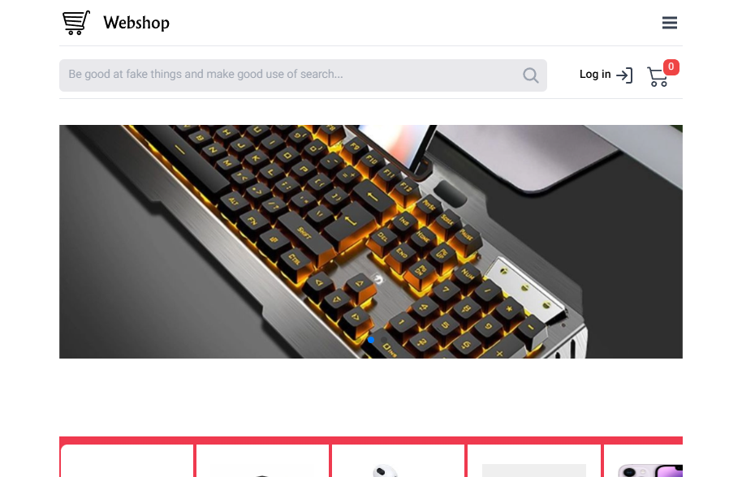
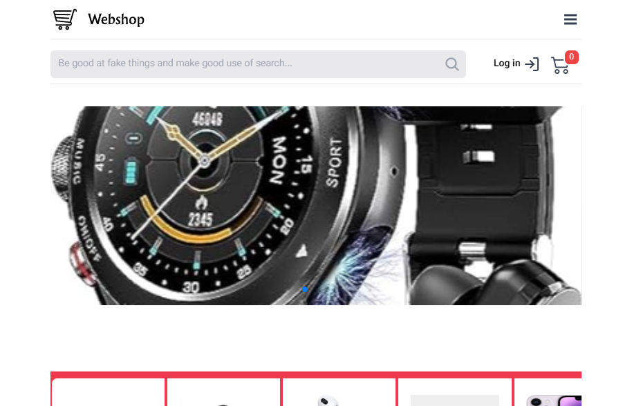
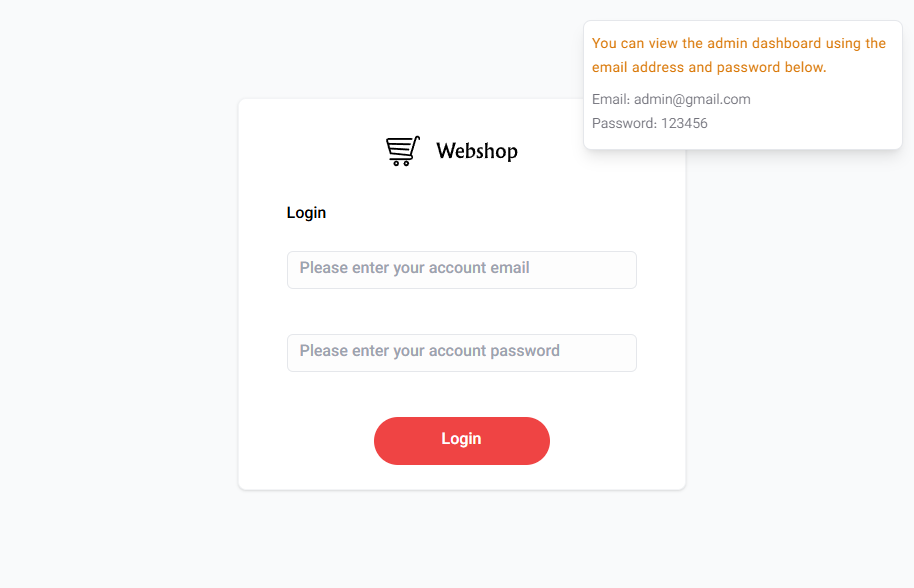
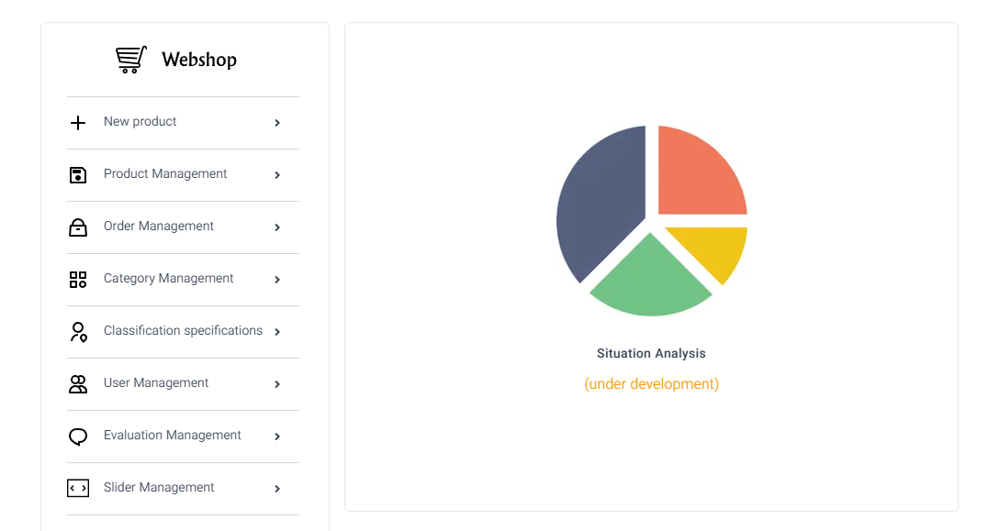
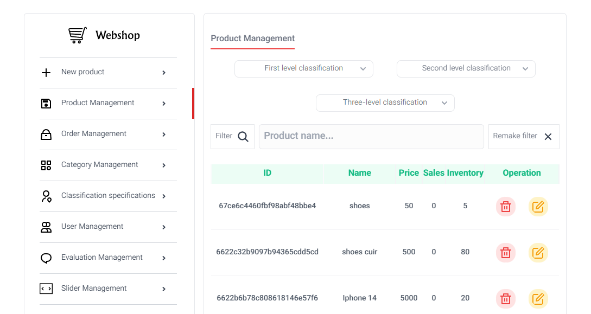
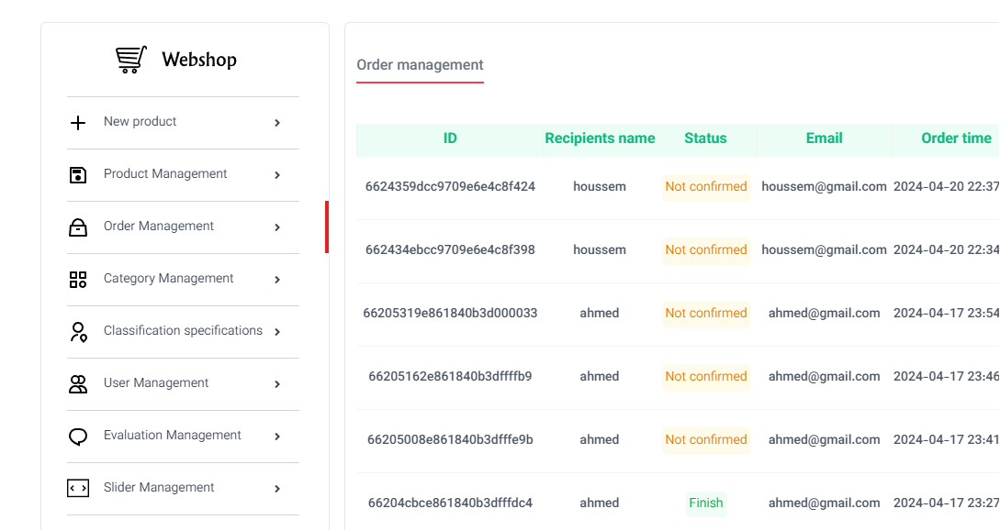
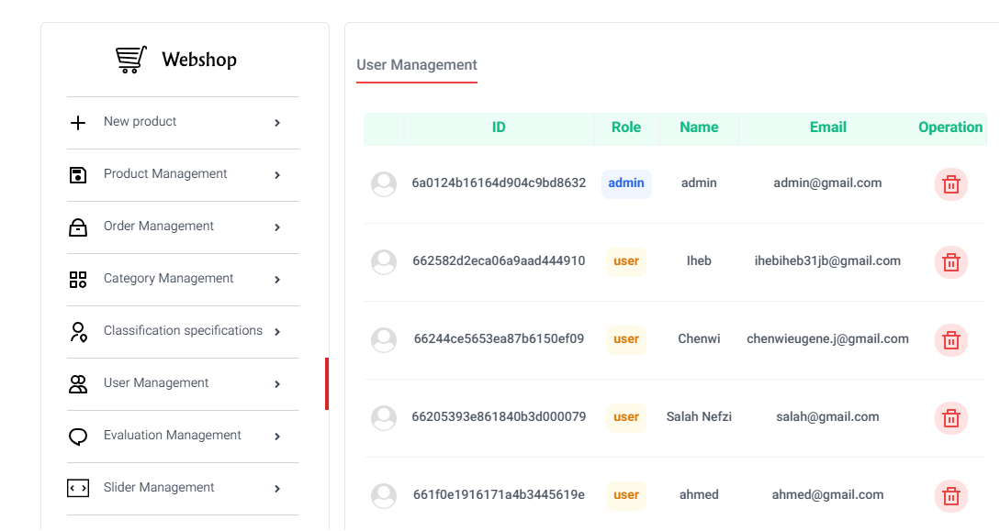

# <!-- Webshop -->

<p align="center">
  
</p>

<h1 align="center">Webshop</h1>

Welcome to Webshop — a journey into the world of e-commerce, unveiling technological wonders.

---

## **User-side**

| Module               | Desktop Devices | Mobile Devices |
|----------------------|-----------------|----------------|
| Home                 |            |           |
| Secondary Category   |            |           |
| Third-level Category |            |           |
| Product Details      |            |           |
| Login                |            |           |
| Register             |            |           |
| Search               |            |           |
| Shopping Cart        |            |           |
| Checkout             |            |           |
| User Profile         |            |           |
| My Orders            |            |           |
| My Reviews           |            |           |
| Address Management   |            |           |
| Recent Visits        |            |           |

---

## **Admin-side**

| Module                  | Desktop Devices | Mobile Devices |
|-------------------------|-----------------|----------------|
| Login                   |            |           |
| Admin Center            |            |           |
| User Management         |            |           |
| Category Management     |            |           |
| Category Tree           |            |           |
| Specification Management|            |           |
| Product Management      |            |           |
| Order Management        |            |           |
| Review Management       |            |           |
| Slider Management       |            |           |
| Banner Management       |            |           |

---

## Desktop Screenshots

### Home (`/`)





### Admin (`/admin`)





### Admin (authenticated)






---

## **Deployment and Usage**

### Development Environment

1. Clone the repo:

```bash
git clone https://github.com/seifeslimene/webshop.git
```

Install dependencies:

```bash
npm install
```

or

```bash
yarn
```

Create a `.env` file from `.env.example`:

```bash
cp .env.example .env
```

### Alibaba Cloud env values

Configure Alibaba Cloud CLI first:

```bash
aliyun configure
```

Get values for `.env`:

```bash
# RAM identity
aliyun sts GetCallerIdentity

# Bucket name and region
aliyun ossutil ls
```

How to fill each variable:

```bash
# Generate locally
NEXT_PUBLIC_ACCESS_TOKEN_SECRET=$(openssl rand -hex 32)

# From "aliyun ossutil ls" Region column (example: oss-eu-central-1)
NEXT_PUBLIC_ALI_REGION=oss-eu-central-1

# From "aliyun ossutil ls" BucketName (without oss://)
NEXT_PUBLIC_ALI_BUCKET_NAME=your-bucket-name

# From RAM Console -> Users -> AccessKey
NEXT_PUBLIC_ALI_ACCESS_KEY=your-access-key-id
NEXT_PUBLIC_ALI_SECRET_KEY=your-access-key-secret

# From "aliyun sts GetCallerIdentity --cli-query Arn" Arn suffix
# Example Arn: acs:ram::123456789:user/seif -> value is "seif"
NEXT_PUBLIC_ALI_ACS_RAM_NAME=your-ram-user-or-role-name

# Optional key prefix in bucket. Leave empty if you do not want a base prefix.
NEXT_PUBLIC_ALI_FILES_PATH=
```

Extract RAM name directly with CLI:

```bash
aliyun sts GetCallerIdentity --cli-query Arn | awk -F/ '{print $NF}' | tr -d '"'
```

### Migrate wrong OSS object prefix (optional)

If old uploads were saved with a wrong prefix such as
`oss://seifeslimene//products/...`, migrate them to clean keys.

Preview wrong-prefix objects:

```bash
B="seifeslimene-webshop"
OLD="oss://seifeslimene//"
aliyun ossutil ls "oss://$B/$OLD"
```

Copy old keys to clean keys (safe, no delete):

```bash
aliyun ossutil cp "oss://$B/${OLD}banners/"  "oss://$B/banners/"  --recursive --update
aliyun ossutil cp "oss://$B/${OLD}icons/"    "oss://$B/icons/"    --recursive --update
aliyun ossutil cp "oss://$B/${OLD}products/" "oss://$B/products/" --recursive --update
aliyun ossutil cp "oss://$B/${OLD}sliders/"  "oss://$B/sliders/"  --recursive --update
aliyun ossutil cp "oss://$B/${OLD}image/"    "oss://$B/image/"    --recursive --update
```

Verify clean paths:

```bash
aliyun ossutil ls "oss://$B/banners/"  | head
aliyun ossutil ls "oss://$B/icons/"    | head
aliyun ossutil ls "oss://$B/products/" | head
aliyun ossutil ls "oss://$B/sliders/"  | head
aliyun ossutil ls "oss://$B/image/"    | head
```

Delete old wrong-prefix keys after verification:

```bash
aliyun ossutil rm "oss://$B/$OLD" --recursive
```

Keep this env value to avoid creating bad keys again:

```bash
NEXT_PUBLIC_ALI_FILES_PATH=
```

### Access the database

This project uses MongoDB and defaults to:

```bash
MONGODB_URL=mongodb://localhost:27017/webshop
```

Access from your host machine (local `mongosh`):

```bash
mongosh "mongodb://localhost:27017/webshop"
```

Access when running with Docker Compose:

```bash
docker compose exec db mongosh
```

Then switch to the project database and inspect data:

```bash
use webshop
show collections
db.users.find().limit(5)
```

Start the project:

```bash
npm run dev
```

Create admin login credentials (development):

```bash
http://localhost:3000/register
```

Register this user in the UI:

- Email: `admin@gmail.com`
- Password: `123456`
- Development only: change these credentials before any production deployment.

Then promote that account to admin in MongoDB:

```bash
use webshop
db.users.updateOne(
  { email: "admin@gmail.com" },
  { $set: { role: "admin", root: true } }
)
```

Admin login page:

```bash
http://localhost:3000/admin/authentication/login
```

Create root category:

```bash
use choiceshop
db.categories.insert({
  name: "Featured Items",
  slug: "choiceshop",
  image: ".webp",
  colors: { start: "#EF394E", end: "#EF3F55" },
  level: 0
})
```

Docker Deployment

```bash
docker compose up -d --build
```

<h4 align="center">© 2026 Webshop</h4>
